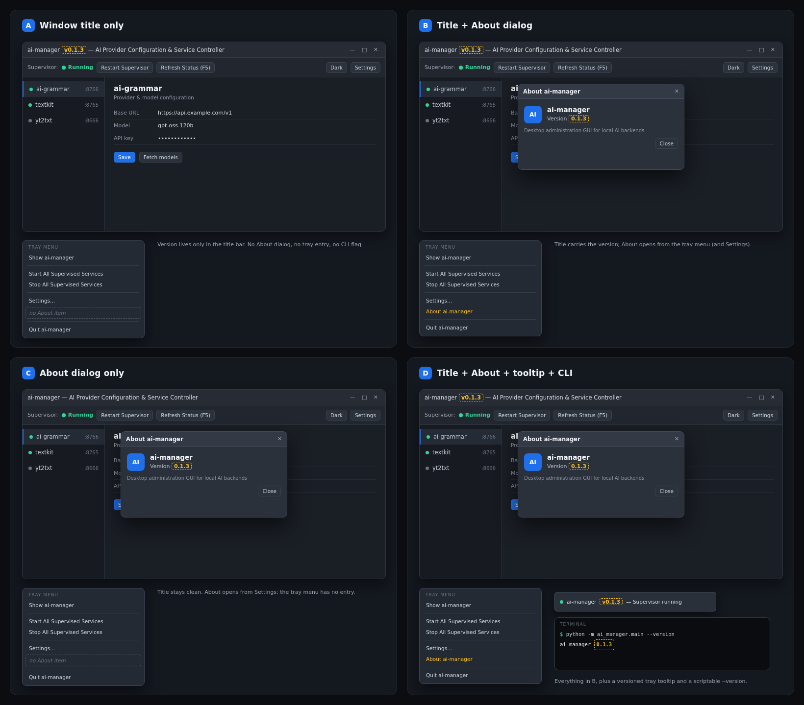

# Design Document: App Version Display

## 1. Background & Goals

`ai-manager` is a PyQt6 desktop GUI for administering local AI backends. The
project has a version (`0.1.3`), but that version is invisible to the person using
the application: there is no title-bar version, no About box, no `--version` flag,
and no status bar. The only ways to learn it today are to read
`src/ai_manager/__init__.py` or `pyproject.toml`.

Worse, the version exists **twice** and is hand-synchronised by a release commit:

- `pyproject.toml` — `version = "0.1.3"` (line 7)
- `src/ai_manager/__init__.py` — `__version__ = "0.1.3"` (line 3)

The last commit on `main` is exactly such a commit (`chore(release): 0.1.3`, which
edits both files). Nothing detects drift between them.

A third fact constrains the design: the application is normally launched from a
source checkout (`./start.sh` → `PYTHONPATH=src python -m ai_manager.main`), and in
that state **the distribution is not installed**, so
`importlib.metadata.version("ai-manager")` raises `PackageNotFoundError`. Any design
that reads version metadata at runtime must therefore carry an exception path on
the primary launch path.

### Goals

1. Show the application version in the main window title and in an About dialog.
2. Make the version impossible to report incorrectly: exactly **one** authored
   literal, with packaging metadata derived from it, so the release bump is a
   one-file edit.
3. Make the About dialog reachable from the two places a desktop user looks: the
   system-tray menu and the Settings dialog.
4. Keep the version read a pure import — no IO, no subprocess, no exception
   handling on the UI path.
5. Pin all of this with tests, including the existing ampersand/mnemonic sweep.

### Non-Goals

- No `--version` command-line flag (explicitly considered and deferred).
- No git build provenance (`0.1.3+g3b1e5b1`, date stamps, dirty detection).
- No license, credits, or third-party-version pane in the About dialog.
- No update checking, telemetry, or "new version available" banner.
- No version in the tray tooltip (rejected in design review of the option set).
- No change to the `0.1.3` value itself; this is a display and single-source change.

## 2. Chosen Option (Mockup Decision)

Four surface sets were rendered as one composite and reviewed with the user:

| Option | Title bar | About dialog | Tray entry | Tray tooltip | CLI flag |
| --- | --- | --- | --- | --- | --- |
| A | yes | no | no | no | no |
| **B (chosen)** | **yes** | **yes** | **yes** | no | no |
| C | no | yes | no | no | no |
| D | yes | yes | yes | yes | yes |

The user selected **B: window title + About dialog**. The mockup composite is the
design record for that decision:



The load-bearing visual commitments from the mockup are:

- the version appears in the **title bar** as a compact `v0.1.3` token, keeping the
  existing title text intact;
- the About dialog is a **small centred modal** carrying the app icon, the name,
  one `Version 0.1.3` line, a one-line description, and a single Close button;
- the tray menu gains **one row** — `About ai-manager` — between `⚙ Settings...`
  and `Quit ai-manager`, with the existing separators preserved around it.

Two implementation-level decisions were settled with the user in the same review:

- **Plain version string** (`Version 0.1.3`), not `0.1.3+<git-sha>`, because there
  is no release automation and a `git describe` call at startup would be slow,
  failure-prone, and wrong for an installed wheel.
- **One literal, derived packaging** (`dynamic = ["version"]`), rather than
  metadata-with-fallback or two literals plus a sync test.

## 3. Architecture

The change is deliberately shallow: one new leaf module, three small edits, and a
packaging config change. There is no new service, state, or persistence.

```text
src/ai_manager/__init__.py          __version__ = "0.1.3"     <-- only authored literal
        ^                     ^
        | import              | setuptools attr: (build time)
        |                     |
src/ai_manager/ui/     pyproject.toml
  main_window.py  ---> title f"ai-manager v{__version__} — ..."
  about_dialog.py ---> AboutDialog(version=__version__)
  settings_dialog.py -> About button --exec--> AboutDialog
  system_tray.py  ---> about_requested signal --(MainWindow)--> AboutDialog
```

### 3.1 Version source of truth

`src/ai_manager/__init__.py` keeps `__version__ = "0.1.3"` and becomes the single
authored source. `pyproject.toml` stops declaring a static version:

```toml
[project]
name = "ai-manager"
dynamic = ["version"]

[tool.setuptools.dynamic]
version = {attr = "ai_manager.__version__"}
```

`attr:` is resolved by setuptools' static AST reader because the assignment is a
module-level string literal in a package with no import-time side effects; the
`src/` layout is already auto-discovered by setuptools. This was verified by
building a wheel from a throwaway copy: it produced
`ai_manager-0.1.3-py3-none-any.whl` with `Version: 0.1.3` in `METADATA`.

Consequence to document, not fix: after raising the version, an editable install
must be re-run before `pip show ai-manager` reflects it. That is inherent to
editable installs.

### 3.2 UI components

**New module `src/ai_manager/ui/about_dialog.py`**

```python
class AboutDialog(QDialog):
    def __init__(self, parent: Optional[QWidget] = None,
                 version: str = __version__) -> None: ...
```

- Window title `About ai-manager`; modal; fixed width (~360 px); no size grip.
- Content, top to bottom: 48 px application icon (`color_icon()` from
  `ui/icons.py`), name `ai-manager` (`aboutNameLabel`), `Version <version>`
  (`aboutVersionLabel`), description `Desktop administration GUI for local AI
  backends` (`aboutDescriptionLabel`), right-aligned `Close` button
  (`QDialogButtonBox.StandardButton.Close`). Because the standard Close button
  carries `RejectRole` and therefore emits `rejected`, the dialog explicitly
  connects that button's `clicked` signal to `self.accept()`. Closing must yield
  `QDialog.DialogCode.Accepted`, and the test asserts that result; a design that
  wired only the button box's `accepted` signal would never fire.
- Read-only: it takes no settings object, performs no IO, emits no signals, and
  never touches `desktop_service`. `version` is injectable so tests can assert the
  rendered string without coupling to the current release number.

Why a QDialog rather than `QMessageBox.about(...)`: the message-box helper renders
unassertable rich text, ignores the application stylesheet, and cannot host the
provenance block we deferred. A ~40-line module is the smaller long-term cost.

**`src/ai_manager/ui/main_window.py`**

- Import `__version__` from `ai_manager`.
- Title becomes
  `f"ai-manager v{__version__} — AI Provider Configuration & Service Controller"`.
  The literal `&` in "Configuration & Service Controller" is **preserved**: the
  window manager draws titles literally, and `tests/test_mnemonic.py` pins that
  property.
- New method `open_about_dialog(self)` → `AboutDialog(self).exec()`.
- Connect `self.tray_manager.about_requested` to `open_about_dialog` alongside the
  existing tray connections.

**`src/ai_manager/ui/system_tray.py`**

- New signal `about_requested = pyqtSignal()`.
- New action `self._about_action`, text `About ai-manager`, inserted after
  `⚙ Settings...` and before the final separator + `Quit ai-manager`. Menu order
  becomes: Show / sep / Start All / Stop All / sep / ⚙ Settings... / About
  ai-manager / sep / Quit.

**`src/ai_manager/ui/settings_dialog.py`**

- Add an `About ai-manager` button to the existing `QDialogButtonBox` via
  `addButton(..., ActionRole)`, so it sits on the left of Save/Cancel and does not
  participate in `accepted`/`rejected`.
- The button opens `AboutDialog(parent=self).exec()` **directly**. Parenting the
  About box to the modal settings dialog keeps it interactive; routing it through
  `MainWindow` would open a dialog owned by an input-blocked parent.

### 3.3 Adjacent pre-existing defect (included)

`pyproject.toml` contains `authors = [{ name = "Henry", email = "henry@local" }]`.
Modern setuptools validates `project.authors[].email` as `idn-email`; a single-label
domain fails, so `pip install -e .` — an install path the README documents — is
already broken at `3b1e5b1` under setuptools 81 and 84. Because this change edits
that same `[project]` table and can only be build-verified through it, the design
includes correcting the address to `wenhepku@gmail.com` (the address on this
repository's own commits).

## 4. Contracts and Edge Cases

| Situation | Required behaviour |
| --- | --- |
| Tray unavailable | About remains reachable from Settings. `SystemTrayManager.is_available()` semantics unchanged; no caching. |
| Settings open | About is parented to the settings dialog, so it is modal *and* clickable, and closing it returns to Settings. |
| About opened twice | Each entry point constructs a fresh dialog; no shared state, no singleton. |
| Version has a pre-release suffix | Title and About render whatever `__version__` says. The format test deliberately pins the **current** release scheme, `MAJOR.MINOR.PATCH`, and must be updated in the same change that introduces a pre-release scheme such as `0.2.0rc1`. Pre-releases are out of scope for this change. |
| Text with `&` | No new mnemonic-aware widget text contains a bare `&`; the About dialog must pass the existing `find_unescaped_ampersand_sinks` sweep. |
| Wheel build | `Version:` in `METADATA` equals `ai_manager.__version__`. |

There is no error-handling path on the version read by design: it is a module-level
literal import. If it were ever missing, the application would fail to import — a
loud, immediate failure rather than a silently wrong title.

## 5. Testing Strategy

| Test | Asserts |
| --- | --- |
| `tests/test_version.py::test_version_is_release_triplet` | `__version__` matches `^\d+\.\d+\.\d+$` exactly. This pins the current release scheme rather than accepting arbitrary PEP 440 forms: a pre-release such as `0.2.0rc1` fails loudly, forcing a deliberate update to both the version scheme and this test. |
| `tests/test_version.py::test_pyproject_derives_version` | `[project]` has no static `version`, declares `dynamic = ["version"]`, and `[tool.setuptools.dynamic].version.attr == "ai_manager.__version__"`. |
| `tests/test_about_dialog.py` | Window title, name label, `Version <version>` text, description, object names; injected version override; clicking Close yields `QDialog.DialogCode.Accepted`; ampersand sweep returns `[]`. |
| `tests/test_main_window.py` (added case) | `window.windowTitle()` contains `f"v{__version__}"` **and** still contains `&`. |
| `tests/test_system_tray.py` | Expanded order/structure test includes `About ai-manager`; triggering the action emits `about_requested`. |
| `tests/test_settings_dialog.py` | About button exists in the button box; invoking it execs `AboutDialog` (patched seam) and does not emit `settings_saved`. |

Verification commands (pinned because the e2e test resolves its workspace from the
process cwd, which differs inside a PM lane worktree):

```bash
AI_WORKSPACE_ROOT=/data/home/guest/Development/ai PYTHONPATH=src pytest tests/
python -m pip wheel --no-deps --no-build-isolation -w dist .   # then read METADATA
```

Recorded baselines at `3b1e5b1`: 216 passed in the base checkout, and 216 passed in
an external worktree with `AI_WORKSPACE_ROOT` pinned. The suite must not regress.

## 6. Risks

1. **Setuptools static attr resolution.** If `__version__` ever stops being a plain
   literal (e.g. computed), `attr:` silently falls back to importing the module at
   build time. Mitigation: `test_pyproject_derives_version` pins the config, and the
   wheel-build verification reads `METADATA`.
2. **Editable-install staleness.** Documented in §3.1; not a runtime bug.
3. **Title string length.** The version token lengthens the title by ~7 characters;
   the mockup was rendered at the real toolbar/title proportions and did not clip.
4. **Test-worktree cwd coupling.** The e2e test's workspace resolution is
   cwd-dependent; the verification command pins `AI_WORKSPACE_ROOT` so a lane
   worktree cannot produce a false failure.

## 7. Documentation

- README: add a feature bullet for the version display and a release note that the
  version is bumped **only** in `src/ai_manager/__init__.py`.
- No user guide exists to update.

## 8. Open Questions

None. Every decision above was either approved explicitly or verified by probe.
