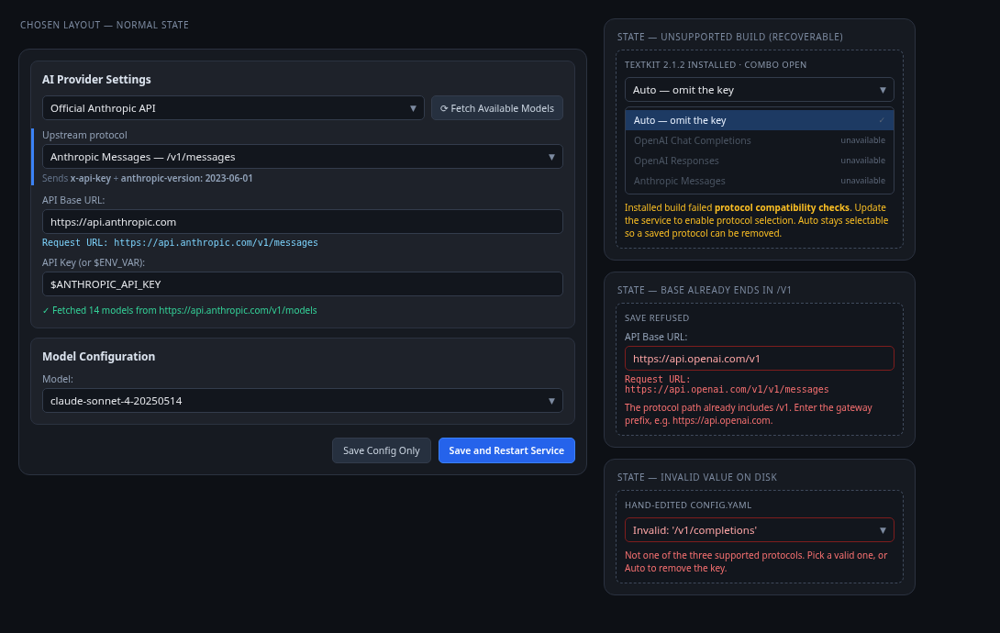

# Endpoint (protocol) selection for managed LLM apps — Design

- Date: 2026-10-20
- Status: Approved by the user (2026-10-20); revised through design reviews 1-6 (all blockers and majors accepted)
- Topic slug: `endpoint-types`

## Background

`ai-grammar` and `textkit` both accept an optional `ai.endpoint` key that selects the upstream
protocol instead of the historical hard-coded Chat Completions path. ai-manager, which edits the
`config.yaml` of both applications, has no notion of the key: it neither shows it nor can introduce
it, and it cannot warn when a saved value is incompatible with the installed build.

The upstream contract was verified against the checkouts on 2026-10-20 and by executing both
loaders; the evidence is in the PM run report `verification-endpoint-types.md`.

| Project | Default branch | Commit | Feature |
| --- | --- | --- | --- |
| ai-grammar | `main` | `6f8c42d` | `SUPPORTED_ENDPOINTS`, `_resolve_endpoint`, adapters |
| textkit | `main` | `f0cc6ce` (tag `2.1.4`) | ported adapters in `01df87a` |

### Verified upstream contract

Exactly three values are accepted:

| `ai.endpoint` | Protocol | Auth headers |
| --- | --- | --- |
| `/v1/chat/completions` | OpenAI Chat Completions | `Authorization: Bearer <key>` |
| `/v1/responses` | OpenAI Responses | `Authorization: Bearer <key>` |
| `/v1/messages` | Anthropic Messages | `x-api-key: <key>` + `anthropic-version: 2023-06-01` |

Rules that the manager must honour:

1. **Key absent = legacy**, and the two projects compose that URL differently:
   - ai-grammar normalises `api_base` to end in `/v1` at load time, then the adapter appends
     `/chat/completions`. Base `https://x` and base `https://x/v1` both request
     `https://x/v1/chat/completions`. A base ending in `/v1/` produces a doubled slash (historical).
   - textkit validates `api_base` (absolute http(s), no query/fragment/userinfo, trailing slashes
     stripped) and concatenates `api_base + "/v1/chat/completions"`. Base `https://x/v1` requests
     `https://x/v1/v1/chat/completions`.
2. **Key present must be one of the three literals.** Both loaders reject anything else, *including
   an explicit `null` or `""`*, with `Unsupported ai.endpoint value: <repr>. Use one of: ...`.
   Therefore "legacy" can only be represented by **removing the key**.
3. **`ai.endpoint` is a base `ai` field only, for different reasons.**
   ai-grammar has no per-task provider-override section at all: its loader reads the base `ai`
   mapping and ignores nested `ocr`/`text` keys. textkit declares `ai.ocr` / `ai.text` as
   `ProviderOverride` (`extra="forbid"`, no `endpoint` field), so a nested endpoint is rejected.
4. **Explicit mode composes the URL by plain concatenation** in both projects: trailing slashes on
   `api_base` are stripped and the endpoint path is appended verbatim. A base whose path already
   ends in `/v1` therefore yields `/v1/v1/<protocol>`.
5. `ai.messages_default_max_tokens` (strict positive integer, default 4096) applies only to
   Messages. The manager does not manage it; round-trip preservation is enough.
6. Temperature handling is **not** uniform and is irrelevant to this feature: ai-grammar always
   sends `temperature` in the Chat Completions body, textkit sends none. The manager changes neither.
7. `yt2txt` has no protocol selection at all: it posts to `{api_base}/audio/transcriptions`.

## Goals

1. Let the user see and change the protocol for `ai-grammar` and `textkit` from the existing
   per-application editor.
2. Never introduce or change `ai.endpoint` to a value that the installed build would reject; never
   write `null` or `""`. Removing the key is always permitted, because legacy works on every build.
3. Leave a configuration that does not use the key byte-identical unless the user changes the
   protocol.
4. Make model discovery use the same auth shape as the selected protocol.
5. Offer a first-class Anthropic preset that is correct on the first click.

## Non-goals

- `yt2txt` protocol selection (its config has no such concept).
- `chat2api` / `file-bridge` (structured schemas; unaffected).
- Managing `messages_default_max_tokens` or per-task `ai.ocr` / `ai.text` `api_base`.
- Auto-normalising or rewriting `api_base`.
- A general service-side config validator for LLM apps (see Risks).

## Architecture

Nine cooperating pieces; each has one purpose and a narrow interface.

### 1. `src/ai_manager/config/protocols.py` (new)

Single source of truth for the protocol vocabulary, so labels, validation, presets, the editor and
the fetcher cannot drift.

```python
LEGACY: Final = None            # sentinel meaning "omit the key"

@dataclass(frozen=True)
class Protocol:
    value: str                  # the exact literal written to ai.endpoint
    label: str                  # combo label, e.g. "Anthropic Messages"
    auth_hint: str              # e.g. "x-api-key + anthropic-version: 2023-06-01"

PROTOCOLS: tuple[Protocol, ...]          # the three literals, in the order above
ENDPOINT_VALUES: frozenset[str] = frozenset(p.value for p in PROTOCOLS)

def is_valid_endpoint(value: object) -> bool:
    return isinstance(value, str) and value in ENDPOINT_VALUES

def compose_request_url(app_id: str, api_base: str, endpoint: str | None) -> str
def base_conflicts_with_endpoint(api_base: str, endpoint: str | None) -> bool
```

`compose_request_url` is **display-only** and reproduces each target's own composition:

```python
raw = api_base.strip()
if endpoint is not None:                 # explicit: identical in both projects
    return raw.rstrip("/") + endpoint
if app_id == "ai-grammar":
    # Reproduce the loader exactly: normalise to /v1 only when absent, PRESERVING a
    # supplied trailing slash, then append /chat/completions. A base of
    # https://x/v1/ therefore previews the historical https://x/v1//chat/completions.
    base = raw if raw.rstrip("/").endswith("/v1") else raw.rstrip("/") + "/v1"
    return base + "/chat/completions"
return raw.rstrip("/") + "/v1/chat/completions"   # textkit: validator strips, then concatenates
```

`base_conflicts_with_endpoint` returns false when `endpoint is None`. Otherwise it inspects **the
path only**, never the host, after stripping trailing slashes: a path ending in `/v1` conflicts. A
host named `v1.example.com` must not conflict, and both `/v1` and `/v1/` must. The predicate is
**total**: `urlsplit` raises `ValueError` on partially typed input such as `https://[` or
`https://[::1`, so it catches `ValueError` and returns `False`. It runs on every keystroke that
updates the Request URL line; an exception must never escape a GUI update.

### 2. `src/ai_manager/services/protocol_capability.py` (new)

Answers one question: does the installed build accept the three literals? Field presence alone is
insufficient — ai-grammar's dataclass field is typed loosely and validation lives in
`_resolve_endpoint`; textkit checks a module-level `SUPPORTED_ENDPOINTS` tuple **before** validating
`AIConfig`, so a model that still accepts a literal proves nothing on its own. The probe therefore
checks **both** the loader's membership guard and the validator, for every literal.

```python
class ProtocolSupportStatus(str, Enum):
    SUPPORTED = "supported"      # every literal verified accepted
    PARTIAL = "partial"          # some literals verified accepted
    UNSUPPORTED = "unsupported"  # no literal verified accepted
    UNVERIFIABLE = "unverifiable"  # the build could not be evaluated

@dataclass(frozen=True)
class ProtocolSupport:
    status: ProtocolSupportStatus
    accepted: frozenset[str] = frozenset()   # verified literals; empty when unknown
    detail: str = ""

def probe_protocol_support(meta: AppMetadata, *, use_cache: bool = True) -> ProtocolSupport
def invalidate_protocol_support(app_id: str) -> None
```

Probe programs, selected by `meta.id`, run with the app's own interpreter (`resolve_app_interpreter`),
`cwd = meta.relative_path`, argv `[interpreter, "-B", "-c", <program>, <nonce>]`, and
`PYTHONDONTWRITEBYTECODE=1` in the environment.

```python
# ai-grammar (app_dir = ai-grammar/backend) — membership guard + the loader's own validator
import json, sys
nonce = sys.argv[1]
try:
    import config
    # _resolve_endpoint is itself the membership guard: it rejects any literal
    # outside SUPPORTED_ENDPOINTS before returning.
    resolve = config._resolve_endpoint
except (ImportError, AttributeError) as exc:
    print(str(exc), file=sys.stderr); raise SystemExit(75)

accepted, rejected = [], []
for value in ("/v1/chat/completions", "/v1/responses", "/v1/messages"):
    try:
        resolve({"endpoint": value}); accepted.append(value)
    except RuntimeError:
        rejected.append(value)
print("PROBE_RESULT:" + nonce + ":" + json.dumps({"accepted": accepted, "rejected": rejected}))
raise SystemExit(0)

# textkit (app_dir = textkit/backend) — membership guard + the model the loader validates
import json, sys
nonce = sys.argv[1]
try:
    import main
    supported = main.SUPPORTED_ENDPOINTS
    model = main.AIConfig
except (ImportError, AttributeError) as exc:
    print(str(exc), file=sys.stderr); raise SystemExit(75)

base = {"api_base": "https://api.openai.com", "api_key": "probe", "model": "probe"}
accepted, rejected = [], []
for value in ("/v1/chat/completions", "/v1/responses", "/v1/messages"):
    try:
        if value not in supported:
            raise ValueError("not in SUPPORTED_ENDPOINTS")
        model.model_validate({**base, "endpoint": value})
        accepted.append(value)
    except Exception:
        rejected.append(value)
print("PROBE_RESULT:" + nonce + ":" + json.dumps({"accepted": accepted, "rejected": rejected}))
raise SystemExit(0)
```

**Result mapping — per literal, not aggregate.** The probe reports which literals it verified, so a
build that accepts Messages but rejects Responses remains usable. The program prints exactly one
final line `PROBE_RESULT:<nonce>:<json>` where `<json>` is
`{"accepted": ["/v1/messages", ...], "rejected": ["/v1/responses", ...]}` and exits `0`. The parent
requires exit `0` **and** that sentinel with the matching per-call nonce; it then derives
`accepted` from the payload and sets `status` to `SUPPORTED` (all three), `PARTIAL` (at least one),
or `UNSUPPORTED` (none). Exit `75`, any other exit, a missing or malformed sentinel, a spawn failure
or the 5 s timeout is `UNVERIFIABLE` with `accepted = frozenset()` and a redacted detail string
(`redact_diagnostics`). The nonce defeats a target module that exits `0` at import before any check
runs, and the payload cannot be forged by exit status alone.

The probe does not reproduce loader-level rejection of an explicit `null`: the manager never writes
`null`, so that rule cannot be violated by this code path.

**Side effects — exact claim.** The probe program itself writes no file and opens no socket, and
`-B` / `PYTHONDONTWRITEBYTECODE=1` prevent bytecode caches. It is **not** a sandbox: importing the
target executes that module's top-level statements, exactly as the service's own startup does. A
target that writes files or opens sockets at import time will do so during a probe; this is accepted
and recorded as a risk rather than claimed away.

**Cache.** Keyed by
`(app_id, interpreter path, interpreter st_mtime_ns, source_fingerprint(app_dir))`, where
`source_fingerprint` is a sha256 over the sorted `(relative path, sha256(file bytes))` of the `*.py`
files under `app_dir` (excluding `__pycache__` and virtualenv directories), so a replacement with
identical mtime and size still invalidates. This invalidates when the checkout is updated, not only
when the interpreter changes. Each app also carries a monotonic `probe_generation`: a restart
increments it, and a finished probe may write its result to the cache and to the view only if its
generation still matches, so an in-flight probe started before an upgrade cannot overwrite a newer
result. If the file set exceeds 200
files the fingerprint becomes **coarse** (count + newest mtimes) **and the result is not cached**:
overflow re-probes on every call rather than risk a stale `SUPPORTED`.
`invalidate_protocol_support(app_id)` is additionally called after every completed restart path
(`_request_saved_restart` success and the manual restart action).

### 3. `src/ai_manager/config/models.py`

- `AppAIConfig.endpoint: Optional[Literal["/v1/chat/completions", "/v1/responses", "/v1/messages"]] = None`
  — enforced by pydantic at construction, so no draft can carry an arbitrary string.
- `AppAIConfig.endpoint_raw: Optional[str] = None` — the unreadable/unsupported value found on
  disk, carried for display only and **never written**.
- `AppMetadata.supports_protocol_selection: bool = False` — true for `ai-grammar` and `textkit`.
  This is a structural fact about the application's schema, not a version check; the probe answers
  the version question.
- `ProviderPreset.endpoint: Optional[str] = None` — `None` means "leave the protocol alone".
- `ModelFetchRequest.endpoint: Optional[str] = None`.
- `ConfigSnapshot(config: AppAIConfig, sha256: bytes, api_base_present: bool)` — what an LLM load
  returns to `MainWindow`. `api_base_present` distinguishes an omitted key from an explicit value
  equal to the manager placeholder, so the Request URL preview can use the target's effective
  default and the no-write rule can avoid materialising it.

### 4. `src/ai_manager/config/app_registry.py`

Named here because the flag defaults to false and nothing else sets it: the `ai-grammar` and
`textkit` `AppMetadata` entries gain `supports_protocol_selection=True`; `yt2txt`, `chat2api` and
`file-bridge` keep the default.

### 5. `src/ai_manager/config/yaml_manager.py`

`_config_from_document` reads the key without failing the whole read:

| On-disk state | `endpoint` | `endpoint_raw` |
| --- | --- | --- |
| key absent | `None` | `None` |
| one of the three literals | that literal | `None` |
| anything else (`null`, `""`, `/v1/other`, non-string) | `None` | `repr(value)` |

Reading must stay tolerant: `MainWindow` currently converts any `read_app_config` exception into a
default `AppAIConfig()`, so raising here would both hide the real config and risk overwriting it on
the next save (see §7 load-failure handling).

For apps where `supports_protocol_selection` is false (`yt2txt`), `ai.endpoint` is **unmanaged**:
the read returns `endpoint=None, endpoint_raw=None` regardless of the file, and the writer neither
sets nor removes the key, so a hand-written value survives the round trip untouched and can never
block a save from a view that has no protocol control.

For participating apps, `_apply_ai_config` writes the protocol as an all-or-nothing rule:

```python
if not meta.supports_protocol_selection:
    pass                              # unmanaged: never set, never pop
elif new_config.endpoint is None:
    ai_sec.pop("endpoint", None)      # legacy means "no key", never null/empty
else:
    ai_sec["endpoint"] = new_config.endpoint
```

**Stale protection and digest advancement.** `read_app_config` gains a snapshot variant returning
`ConfigSnapshot(config, sha256(raw bytes))`; `MainWindow` keeps the digest beside its saved baseline
and passes it as `expected_sha256` to the existing transaction path, so an external edit between load
and save raises `StaleDocumentError` instead of being overwritten (and instead of deleting an
`endpoint` another process just added).

`write_app_config(meta, new_config, *, baseline, expected_sha256=None) -> bytes` becomes the single
commit point and **returns the sha256 of the exact bytes it installed**. `MainWindow` installs the
config and the new digest together only after success; a failed or stale save advances neither. After
a dependent rewrite, `_reconcile_dependent_views` re-reads each dependent through the snapshot
reader and installs `(baseline, digest)` pairs, so a subsequent LLM save is not falsely stale.

**Diff-based application.** `_apply_ai_config(meta, doc, new_config, baseline)` writes a managed
field only when it differs from `baseline`:

| Field | Written when | Absent/empty representation |
| --- | --- | --- |
| `ai.api_base` | differs from `baseline.api_base` | — (the reader defaults it; an untouched default is never written) |
| `ai.api_key` | differs from `baseline.api_key` | — |
| `ai.endpoint` | `draft.endpoint != baseline.endpoint` **or** `baseline.endpoint_raw` is set | `None` -> key removed |
| base `ai.model` | unified mode and differs from `baseline.model` | `None` -> key removed, never `""` |
| `ai.ocr.model` / `ai.text.model` | split mode and differs from the baseline value | `None` -> key removed |

A model field whose new value is `None`/empty is **removed** rather than written as `""`, because
textkit's base `model` has `min_length=1` and an empty string fails startup. The split/unified
toggle applies its structural change only when `is_split_model` differs from the baseline; that
toggle is the one intentionally destructive action (it removes the now-inactive model section,
including its provider overrides, exactly as today).

`baseline.endpoint_raw` forces an endpoint write even when `draft.endpoint == baseline.endpoint`:
the on-disk value is an unrecognized string that `endpoint` never captured, so selecting `Auto` on
such a file must actively remove the key. Without this rule the invalid value would survive forever.

**No-op saves write nothing.** If the draft equals the saved baseline and no restart was requested,
the save path returns before rendering. Goal 3 is therefore "an unchanged draft produces **no file
write at all**", which holds for any document shape.

One rule governs every other save: **a managed field is written only when it changed; an absent
value is never materialised.** `api_base` and `api_key` are therefore not written back when the
document omitted them and the user did not edit them, and `api_base`'s presence is carried in the
snapshot (`api_base_present`) so the preview uses the target's effective default rather than the
manager's placeholder. This replaces the older behaviour where any save rewrote the managed keys.

`endpoint_raw` is never written. ruamel round-trip continues to preserve comments, ordering and
unmanaged keys (`messages_default_max_tokens`, `temperature`, `endpoints`, per-task overrides).

### 6. `src/ai_manager/ui/app_detail_view.py`

Chosen layout (Option A): a labelled **`Upstream protocol`** row between the preset row and
`API Base URL:`. Items are `Auto — omit the key` (data `None`) followed by the three protocols,
each rendered as `<label> — <value>`.



The preset row text in the mockup is illustrative; the preset list is defined in §9. All other
strings shown in the mockup are normative and are reproduced verbatim below.

Under the combo, a hint line shows the selected protocol's auth shape; `Auto` gets its own explicit
hint ("legacy Chat Completions - Authorization: Bearer"). Under the base field, a read-only
`Request URL:` line shows `compose_request_url(meta.id, base, endpoint)` using the target's
effective default when `api_base_present` is false; it turns red when
`base_conflicts_with_endpoint` is true. While `endpoint_raw` is set, both the hint and the URL line
render as unavailable with the repair message instead of showing a plausible legacy URL.

The view exposes:

```python
def set_protocol_support(self, support: ProtocolSupport) -> None
```

Item availability is a small precedence table over (capability status, stored state). "Stored"
means the value read from the file. A protocol item is enabled only when both axes allow it.

| Status | stored `None` | stored explicit `v` | stored invalid |
| --- | --- | --- | --- |
| `SUPPORTED` (accepted = all three) | all four | all four | all four |
| `UNVERIFIABLE` | all four | all four | all four |
| `PARTIAL` | `Auto` + accepted literals | `Auto` + accepted literals + `v` | `Auto` + accepted literals |
| `UNSUPPORTED` (accepted = empty) | `Auto` only | `Auto` + `v` | `Auto` only |

The stored value is always selectable even when it failed verification, so the user can keep it or
switch to `Auto`; a *changed* value still has to pass the gate.

Disabled items render greyed with the suffix `unavailable`. The mockup illustrates the
`UNSUPPORTED` + `None` cell (no literal accepted); with `PARTIAL`, only the rejected literals are
greyed.

| State | Rendering |
| --- | --- |
| `meta.supports_protocol_selection` false | row not created at all (`yt2txt`) |
| probe `PARTIAL` / `UNSUPPORTED` | amber reason: "Installed build failed protocol compatibility checks. Update the service to enable protocol selection. Auto stays selectable so a saved protocol can be removed." Both `PARTIAL` and `UNSUPPORTED` mean "this build cannot take every protocol", never "the key is absent". |
| probe `UNVERIFIABLE` | amber notice "Protocol support could not be verified — validated by ai-manager only." plus the probe detail in the existing error-details panel. The save gate still refuses a new protocol (§7). |
| `endpoint_raw` set | combo shows `Invalid: <repr>` in the error style. Selecting `Auto` or a valid protocol clears `endpoint_raw` and marks the tab dirty; under `UNSUPPORTED` only `Auto` is selectable, which is the repair path. |

`load_config` selects the combo entry from `config.endpoint` (or the invalid state). The view owns
`_endpoint_raw` for the loaded file: `get_current_draft` always copies it alongside the combo value,
and only an explicit `Auto` or valid-protocol selection clears it. A draft for an unrelated edit
(model, key, base) therefore still carries the invalid raw value, so the gate keeps refusing and the
writer cannot silently delete an unrecognized key. The combo participates in `config_changed` dirty tracking, so switching protocol marks
the tab dirty exactly like editing the base URL.

### 7. `src/ai_manager/ui/main_window.py`

- **Load-failure state (new).** `_load_config` for LLM apps no longer swallows a read failure into a
  default `AppAIConfig()`. It records `_load_failed[app_id] = True`, shows the error through the
  view's `show_config_error(message, detail)` plain-text label, disables the save buttons, and clears the flag on the next
  successful load. This closes the path where a failed read is later saved as "Auto" and deletes a
  working `endpoint`.
- **Load-time probe**: at view construction, for each app with `supports_protocol_selection`, start a
  `ProtocolProbeJob` (QRunnable + `ConfigJobSignals`, same shape as `LauncherProbeJob`) carrying a
  per-app token so a stale result cannot overwrite a newer one. On completion call
  `view.set_protocol_support(...)`. The editor stays usable while the probe runs.
- **Recovery actions.** Two states must be escapable without restarting the manager:
  - Load failure and `StaleDocumentError` render a `Reload configuration` button in the existing
    error area, wired to the existing `MainWindow._reload_config(app_id)`. LLM stale errors are
    handled by a typed branch that never enters the structured recovery dialog (which assumes a
    `StructuredDoc` with `kind`): it keeps the draft, disables saving, and installs a new
    config/digest only after a successful snapshot reload. A successful reload
    clears `_load_failed`, installs the new baseline and digest, and re-enables saving. `_reload_config`
    already discards a stale draft after confirmation for structured apps; for LLM apps it keeps
    the draft only when the digest still matches.
  - Every completed restart (saved-restart and manual `Restart Service Only`) calls
    `invalidate_protocol_support(app_id)` and then starts a fresh token-checked `ProtocolProbeJob`,
    applying the result with `set_protocol_support` **without touching the draft**. Upgrading a
    target therefore re-enables the protocol items in the same session.
- **Managed-field rebase across a dependent rewrite.** `adopt_saved_baseline(config,
  preserve_draft=True)` installs the committed baseline while the widgets keep the old draft. This
  is a three-way merge per managed field (loaded `L`, committed `C`, draft `D`):
  - `D == L` (user did not touch it) -> adopt `C` into the draft and its widget silently, with no
    `config_changed`. This is what stops a chat2api `api_base` rewrite from being written back by
    the next save, and stops a silently changed protocol from being deleted.
  - `D != L` and `C == L` -> keep the user's pending edit; nothing changed on disk.
  - `D != L` and `C != L` and `D == C` -> both sides agree; clear the edit flag.
  - `D != L` and `C != L` and `D != C` -> genuine both-changed conflict for that field.

  A conflict on `endpoint`, `api_base` or `api_key` sets `_baseline_conflict[app_id]`; the error
  area explains it and offers `Reload configuration`, and the save gate refuses (rule 1a). A
  conflict on a model field is resolved the same way. The view tracks `_loaded_endpoint`,
  `_loaded_endpoint_raw` and `_protocol_edited`, and derives edit intent from `D != L` rather than
  from a sticky flag, so changing the combo away and back is not a conflict.

  The gate gains rule `1a`: `_baseline_conflict[app_id]` -> refuse until reload.
- **Save gate — the single LLM commit path.** `_on_save_requested` is the only place an
  `AppAIConfig` is written. Its LLM branch is replaced by this sequence, and no other caller may
  invoke `write_app_config` for an LLM app:

  ```python
  snap = self._snapshots[app_id]                # ConfigSnapshot installed at load/reload/commit
  rules = self._evaluate_llm_gate(app_id, draft, snap.config)   # rules 1a..7, in order
  if rules.refused:  show(rules.message); return
  if rules.no_op:    if should_restart: self._request_saved_restart(app_id); return
  installed = write_app_config(meta, draft, baseline=snap.config, expected_sha256=snap.sha256)
  self._snapshots[app_id] = ConfigSnapshot(draft.model_copy(deep=True), installed,
                                           snap.api_base_present)
  self._saved_configs[app_id] = draft.model_copy(deep=True)
  ```

  `write_app_config` returns the digest of the exact bytes it installed; the snapshot is replaced
  only after a successful commit, so a refusal, a stale write or an exception leaves the previous
  baseline, digest and `api_base_present` intact. The view receives the same `ConfigSnapshot` in
  `load_config` / `adopt_saved_baseline`, so the Request URL preview knows whether the file
  actually contains `ai.api_base`. Load-failure, baseline-conflict, invalid-raw, URL-conflict,
  capability and stale protection therefore all sit on the one path a save can take.

- **Gate rules**, evaluated in order, before any byte is written:

  | # | Condition | Result |
  | --- | --- | --- |
  | 0 | the **normalized** draft equals the saved baseline, **after rules 1a-4 have all passed** | skip rendering and writing entirely, **whether or not a restart was requested**; a requested restart still runs on its own |
  | 1 | `_load_failed[app_id]` | refuse: reload the configuration before saving |
  | 1a | `_baseline_conflict[app_id]` (user-edited protocol vs a committed dependent rewrite) | refuse: reload before saving |
  | 2 | `draft.endpoint` is not `None` and not a supported literal | refuse (unreachable with the `Literal` type; kept as a boundary assertion) |
  | 3 | `draft.endpoint_raw` is set | refuse: repair the invalid value first (the view clears it on selection) |
  | 4 | `draft.endpoint is not None and base_conflicts_with_endpoint(base, draft.endpoint)` | refuse: "The protocol path already includes /v1. Enter the gateway prefix, e.g. https://api.openai.com." This runs for **every** explicit endpoint, including unchanged ones, so a base-only edit cannot produce `/v1/v1/...` |
  | 5 | protocol **removed** (`draft.endpoint is None`, saved not `None`) | allow; skip capability entirely. Removing the key is the universal repair |
  | 6 | protocol **unchanged** (`draft.endpoint == saved.endpoint`) | allow; skip capability |
  | 7 | protocol **introduced or changed** | 7a app lacks `supports_protocol_selection` -> refuse; 7b the chosen literal is in `support.accepted` -> allow; 7c the literal is verified rejected (`SUPPORTED`/`PARTIAL`/`UNSUPPORTED` with the literal absent from `accepted`) -> refuse, naming that literal; 7d `UNVERIFIABLE` -> refuse with detail and "cannot verify this build". A `PARTIAL` build may therefore use the literals it actually accepts |

  Rules 5 and 6 run **before** 7, and rule 4 runs before both, so removal is always permitted and a
  capability failure can never depend on an unrelated base edit.
  Rule 0 compares normalized values: an empty model control normalizes to `None`, matching how the
  reader represents an absent key, so an untouched form does not look dirty. The no-write decision
  is independent of `should_restart`; "Save and Restart" on an unchanged form restarts without
  touching the file.

  Rule 0 runs last among the refusal rules: an unchanged draft must still be refused when the file
  is unreadable, in conflict, invalid on disk, or would compose a doubled `/v1`. It only decides
  whether a *permitted* save needs to touch the file. Rules 5–7 are what make `UNVERIFIABLE` safe: an unknown build can never receive a new protocol
  value, while the user can always repair a config back to legacy.
- Save remains synchronous on the GUI thread; the probe is normally a cache hit from load time. A
  cold miss is bounded by the 5 s timeout and degrades to `UNVERIFIABLE`, which now refuses rather
  than allows a protocol change.

### 8. `src/ai_manager/services/model_fetcher.py`

`fetch_models_sync` chooses headers from `request.endpoint`:

```python
if request.endpoint == "/v1/messages":
    headers["x-api-key"] = resolved_key
    headers["anthropic-version"] = "2023-06-01"
else:
    headers["Authorization"] = f"Bearer {resolved_key}"
```

Discovery paths (`{base}/v1/models`, then `{base}/models`), normalisation, timeouts, error text and
the token-based stale-response guard are unchanged. `ModelFetchRequest.endpoint` is populated in
`_on_fetch_clicked` from the current draft (not from the saved baseline), so the request always
describes the protocol the user is looking at; a view→worker propagation test pins this.

### 9. `src/ai_manager/config/presets.py`

`ProviderPreset.endpoint` is added with default `None`. One new preset is appended:

```python
ProviderPreset(
    id="anthropic_official",
    name="Official Anthropic API",
    api_base="https://api.anthropic.com",
    default_key_env_var="ANTHROPIC_API_KEY",
    endpoint="/v1/messages",
    docs_url="https://docs.anthropic.com",
    description="Claude models over the Anthropic Messages protocol",
)
```

`ProviderPreset.endpoint` is typed as `Optional[Literal[...]]` over the same three literals, so a
persisted custom preset cannot carry an unsupported value. One helper resolves a preset by id for
population, matching and selection; the three call sites never re-implement lookup. Three rules keep
the preset usable and safe:

1. **Offering.** A view whose app lacks `supports_protocol_selection` (or whose row is absent) only
   lists presets with `endpoint is None`; the Anthropic preset is omitted there. This prevents a
   preset handler from touching a combo that does not exist.
2. **Applying.** `_on_preset_selected` sets the base URL and key env as today, and additionally
   selects the protocol when `preset.endpoint is not None`. Presets with `endpoint=None` leave the
   current protocol untouched.
3. **Matching and activation.** Load-time preset matching compares `(api_base.rstrip("/"),
   endpoint)` when the preset pins a protocol and only the base otherwise, so an Anthropic base saved
   with a different protocol does not show as already selected. The handler is also connected to
   `QComboBox.activated`, so re-selecting the current index still applies the preset's base, key and
   protocol — including the "correct on the first click" case.

Persisted `custom_presets` in `settings.json` remain valid through the field default.

## Data flow

```
read_app_config  ->  ConfigSnapshot(AppAIConfig(api_base, api_key, model|split, endpoint, endpoint_raw), sha256)
       └─ AppDetailView: combo + auth hint + Request URL line
            └─ draft (config_changed → dirty indicator)
                 └─ save_requested
                      └─ MainWindow save gate (load-failure → literal → raw → URL → removal/unchanged → capability)
                           └─ write_app_config(expected_sha256=loaded digest)   [skipped when the draft is unchanged]
                                └─ optional restart → invalidate + re-probe → set_protocol_support
```

## Error handling and degradation

| Condition | User-visible behaviour | File written? |
| --- | --- | --- |
| Probe rejects the chosen literal, protocol introduced/changed | that literal's item disabled; save refused naming it | no |
| Probe rejects the stored literal, protocol removed or unchanged | allowed (removal is the repair path) | yes |
| Probe `UNVERIFIABLE`, protocol introduced/changed | amber notice at load; save refused with the probe detail | no |
| Probe `UNVERIFIABLE`, protocol removed or unchanged | allowed with notice | yes |
| `endpoint_raw` present | `Invalid: <repr>`; save refused until a valid value or `Auto` is selected (under `UNSUPPORTED`, `Auto` only) | no |
| Base path ends in `/v1` with an explicit protocol, **changed or not** | red `Request URL`; save refused with the exact URL | no |
| Configuration read failed | error shown, save buttons disabled, `Reload configuration` offered | no |
| File changed on disk since load (`StaleDocumentError`) | stale error shown, draft kept, `Reload configuration` offered | no |

## Specification obligations

These are integration contracts the technical specification must pin exactly. They are listed here
so the design stays at architecture altitude without losing a requirement.

1. **Writer threading.** `_apply_ai_config(meta, doc, new_config, baseline)` and
   `write_app_config(meta, new_config, *, baseline, expected_sha256=None) -> bytes` replace the
   current three-argument apply and the two rendering branches; every existing test call site is
   updated. `render_app_config` keeps its pure signature.
2. **Metadata through the reader.** `_config_from_document(doc, meta)` and the snapshot reader take
   `AppMetadata`, and every caller (load, blast radius, dependent commit, snapshot) passes it, so
   endpoint ownership and split-model classification follow the app rather than the document shape.
3. **Dependent snapshots.** `SaveResult.saved_dependents` must carry the rewritten paths or full
   snapshots so `_reconcile_dependent_views` can install `(config, digest)` atomically; dependent
   rewrite no longer returns bare `AppAIConfig` values.
4. **Typed stale path.** An LLM `StaleDocumentError` is handled without the structured recovery
   dialog and without assuming `StructuredDoc`.
5. **Probe generation.** `invalidate_protocol_support` increments the app generation; a completed
   probe applies only when its generation still matches.
6. **Preset vocabulary.** `ProviderPreset.endpoint` is the same `Literal` union, and one resolver
   backs population, matching and selection.
7. **Fetch propagation.** `ModelFetchRequest.endpoint` is filled from the draft in the view and
   consumed by the fetcher.

## Testing strategy

**Unit**

- `protocols`: validity for the three literals plus `None`; rejection of `null`, `""`, aliases and
  full URLs; `compose_request_url` per app — ai-grammar legacy with bases `https://x`,
  `https://x/v1`, `https://x/v1/` asserting the exact `https://x/v1//chat/completions` quirk for the
  last; textkit legacy with the same three; explicit mode identical for both; `/v1` predicate true
  for `/v1` and `/v1/`, false for `https://v1.example.com` and for legacy.
- `yaml_manager`: read matrix from §5; unmanaged apps ignore a stray endpoint and preserve it
  byte-for-byte; write sets the key; write with `None` **removes** an existing key; comments, quoted
  strings, ordering and unmanaged keys survive; an unchanged draft performs **no write at all**,
  asserted with a read-only file and with a file whose formatting differs from the renderer.
- `protocol_capability`: synthetic app dirs — a `config.py` with a validating `_resolve_endpoint`
  (supported); one whose validator rejects `/v1/responses` (unsupported); one where the module-level
  guard excludes a literal the model still accepts (unsupported — the review-2 blocker); one whose
  `_resolve_endpoint` is missing (unverifiable); one importing a module that exits `0` at import
  (unverifiable — no sentinel); a sleeping fixture for the timeout; a fixture that writes a file at
  import (asserts the documented residual behaviour, not a sandbox). Assert all outcomes, that the
  nonce sentinel is required, that the cache avoids a second subprocess, that a source mtime change
  invalidates it, that >200 files disables caching, and that `-B`/`PYTHONDONTWRITEBYTECODE` leaves no
  `__pycache__` behind.
- `model_fetcher`: header selection per protocol against a mocked transport; Bearer unchanged for the
  two OpenAI protocols and for `None`.
- `presets`: the Anthropic preset pins `/v1/messages`; selecting a preset with `endpoint=None` leaves
  the draft protocol untouched; endpoint-bearing presets are not offered where the row is absent;
  re-selecting the already-current preset still applies it (`activated` path).
- `app_registry`: flags true for `ai-grammar` and `textkit`, false for the other three.
- Preset offering: a view without the protocol row lists no endpoint-bearing preset.
- `protocols`: `base_conflicts_with_endpoint` returns `False` (never raises) for `https://[` and
  `https://[::1`, and recovers to the correct result once the base is completed.
- Reconciliation (all four branches of the three-way merge): unedited + unchanged file; unedited +
  file changed (adopts silently); edited + file unchanged (pending edit survives, no conflict);
  edited + file changed and agreeing (conflict cleared); edited + file changed and disagreeing
  (baseline conflict, gate refuses, reload resolves).
- Invalid repair: a file with `endpoint: "/v1/completions"` loaded and switched to `Auto` must have
  the key removed — assert against the exact bytes, not just the parsed config.

**GUI (pytest-qt)**

- Combo population and order; `yt2txt` view has no protocol row.
- `set_protocol_support` for each of the four states, including that `Auto` stays selectable when
  `UNSUPPORTED` and the three protocol items are disabled.
- Invalid-on-disk state renders; selecting `Auto` or a valid protocol clears it and marks dirty.
- The availability precedence table: `UNSUPPORTED` with a stored explicit protocol keeps `Auto` and
  that one item enabled and disables the other two; `UNSUPPORTED` with `endpoint_raw` keeps only
  `Auto`.
- Derived `Request URL:` text per app and its red state for `/v1` and `/v1/`.
- Dirty tracking on protocol change, preset selection and preset with `endpoint=None`.
- Load-failure and stale states disable saving and expose `Reload configuration`; a successful
  reload re-enables it.
- A completed restart triggers a fresh probe and applies the new availability without changing the
  draft.

**Integration**

- Save into `tests/fixtures/ai_grammar_config.yaml` and `textkit_split_config.yaml` copies: set
  protocol, remove protocol (**including under `UNSUPPORTED` and `UNVERIFIABLE` — the review-2
  ordering bug**), legacy untouched, blocked-by-probe (unsupported and unverifiable introduction),
  blocked-by-`/v1` both when the protocol changes and when only the base changes, blocked-by-
  `endpoint_raw`, and load-failure-disabled save; assert exact resulting bytes plus `.bak` and mode
  preservation.
- Stale save: load, modify the file externally to add `ai.endpoint`, save an unrelated edit; assert
  `StaleDocumentError`, no bytes written, and the key preserved.
- Digest advancement: two consecutive saves of different drafts both succeed without a manual
  reload; after a dependent rewrite, an LLM save is not falsely stale; a failed save advances
  neither baseline nor digest.
- No-op saves: on a read-only file, and on a valid file that omits `ai.model`, an untouched draft
  must not attempt a write — for both "Save Config Only" and "Save and Restart"; assert no new
  `.bak` and unchanged mode and bytes.
- Provider overrides: a textkit file with a non-default base model plus provider-only
  `ai.text`/`ai.ocr` fields survives a **protocol-only** save unchanged. The explicit
  split/unified toggle is the one documented destructive exception and is tested as such.
- Partial-support build: a fixture whose guard accepts `/v1/chat/completions` and `/v1/messages`
  but rejects `/v1/responses` yields `PARTIAL` with `accepted` holding the two; the view disables
  only `/v1/responses`, and a save selecting `/v1/messages` is allowed while selecting
  `/v1/responses` is refused. The compatibility-check wording is used, never "has no ai.endpoint".
- Omitted base: a file without `ai.api_base` previews the target's effective default
  (ai-grammar legacy `https://api.openai.com/v1`, textkit `https://api.openai.com`) and an untouched
  save does not materialise the key.
- `yt2txt` with a hand-written `ai.endpoint`: the view has no row, saving other edits succeeds, and
  the key is preserved verbatim.
- **Save-gate seams** driven through `_on_save_requested` (not the helpers): one case per refusal
  rule 1a-7, the no-op case, and a successful case asserting the writer received `baseline` and the
  loaded digest and that the returned digest was installed.
- **Rebase seams**: an untouched dependent `api_base` is adopted from the committed baseline and a
  subsequent save keeps it; a user-edited field survives; a both-changed field raises the conflict.
- **Probe race**: a probe result from an older generation is discarded after a restart.
- Regression: a chat2api listener change that rewrites a dependent's `ai.api_base` leaves
  `ai.endpoint` unchanged.

## Risks

1. **Importing target code executes its top-level statements.** textkit's `main.py` imports FastAPI.
   `-B` and `PYTHONDONTWRITEBYTECODE=1` stop bytecode caches only; they are **not** a sandbox. A
   target that writes files or opens sockets at import time does so during a probe exactly as it does
   at service start. Accepted residual risk; enforced only by the 5 s timeout and `UNVERIFIABLE`.
2. **Probe/loader drift.** The probe calls `_resolve_endpoint` in ai-grammar and
   `SUPPORTED_ENDPOINTS` + `AIConfig.model_validate` in textkit. A rename, removed symbol or type
   change surfaces as `UNVERIFIABLE` (exit 75), never as a false `SUPPORTED`; the save gate then
   refuses new protocol values.
3. **Losing the key on unrelated edits.** `AppAIConfig` is constructed in `_config_from_document`,
   `get_current_draft`, and the `_load_config` failure path; the last one is now an explicit
   load-failure state that cannot be saved. `Auto` must be an explicit user action. An endpoint added
   by another process after load cannot be deleted, because every LLM save carries the loaded digest
   through `expected_sha256`.
4. **No LLM service-side validation exists.** This design adds capability checking only; a wrong base
   URL or model is still not validated. Documented, not silently implied.
5. **Probe cost.** One subprocess plus a small source scan per chat app per session
   (textkit ~0.5–1 s), cached afterwards and invalidated by source, interpreter or restart changes.

## Documentation

`README.md` gains a short subsection under "Applications Managed": the three protocol values, the
auth differences, that `Auto` omits the key, the `/v1` base rule, and that `textkit` requires 2.1.4
or newer while `ai-grammar` support arrived with `6f8c42d`.

## Out of scope / follow-ups

- A generic LLM candidate validator (would also catch invalid `api_base` for textkit).
- Editing `messages_default_max_tokens` and per-task provider overrides.
- Protocol-aware health checks or restart gating.
