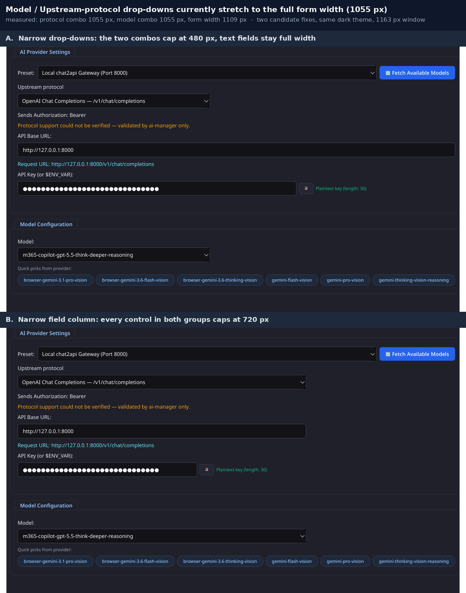

# Drop-down width in the AI Provider / Model Configuration forms

Date: 2026-10-27
Status: design agreed (option A selected by the operator)

## Background

Reported bug: "The drop-down text box is too wide."

The two `QComboBox` controls in `AppDetailView` — `Upstream protocol` (shown when
`AppMetadata.supports_protocol_selection` is true) and `Model` (shown in the unified
model box, mirrored by `OCR Model` / `Text Model` in split mode) — are added to a
`QVBoxLayout` without any width constraint. Because the neighbouring `QLineEdit`
controls use the default `Expanding` policy and the combos use `Preferred`, each
combo is stretched to the entire form column.

Measured on the shipping build at a 1163 px window, dark theme
(`get_stylesheet(ThemeMode.DARK)`), `QT_QPA_PLATFORM=offscreen` and under Xvfb:

| Control | Width |
| --- | --- |
| form content column (inside the scroll area) | 1109 px |
| `Upstream protocol` combo | 1055 px |
| `Model` combo | 1055 px |
| `API Base URL` `QLineEdit` | 1055 px |
| `API Key` line edit | 1055 px (inside its row widget) |

A combo whose value is 22 characters wide therefore occupies a 1055 px box, with the
drop-down affordance sitting roughly 1000 px away from the value it describes. The
`Preset:` combo in the same group is *not* affected in practice, because its row is
anchored on the right by the `Fetch Available Models` button.

## Goals

1. The two dropdowns stop stretching across the whole form column and instead read as
   dropdowns sized for their content.
2. Button/field alignment elsewhere in the view is unchanged: `API Base URL` and
   `API Key` stay full width, because their values are long and benefit from it.
3. No protocol label or realistic model name is visually truncated at the default
   theme and window size.
4. Split model mode (`OCR Model`, `Text Model`) follows the same rule, so the three
   model combos never disagree in width.

## Non-goals

- The drop-down *popup* list width (it is already driven by the combo width and its
  item contents; not part of this report).
- `Preset:` combo width, the quick-picks chip row, and the footer bar.
- `SettingsDialog`'s combos: they already live in a `QFormLayout` label column.
- Any theme, colour, spacing, or typography change.

## Options considered

The operator was shown two rendered candidates built from the real widget and chose A.



- **A (chosen)** — cap the dropdowns at a shared maximum width (480 px); text fields
  keep the full column width.
- **B (rejected)** — cap every control in both groups at one shared 720 px column.
  Rejected because it shrinks the URL and API-key fields, which legitimately hold long
  values, and leaves three different right edges (preset toolbar row and chip row are
  unaffected by the cap).

## Design

### Constant

A module-level constant in `src/ai_manager/ui/app_detail_view.py`:

```python
DROPDOWN_MAX_WIDTH = 480
```

Rationale for 480 px (measured with the current theme, `QFontMetrics` against each
widget's font):

- The widest upstream-protocol label, `OpenAI Chat Completions — /v1/chat/completions`,
  needs 348 px including padding and the arrow subcontrol.
- The 43-character model name `m365-copilot-gpt-5.5-think-deeper-reasoning` needs
  roughly 284 px.
- 480 px leaves headroom for the longest realistic model ids while still ending far
  short of the 1055 px column, which is the reported defect.

The value is expressed in Qt logical pixels, matching the theme's fixed pixel
typography in `theme.py`. It is not derived from the window width, so the layout is
stable across window sizes; the combos shrink below 480 px when the column is
narrower than that, exactly as any other widget does.

### Application

`AppDetailView._init_ui` applies the cap at construction time, in one place per combo:

- `self._protocol_combo` (inside the `supports_protocol_selection` branch)
- `self._model_combo`
- `self._ocr_combo`
- `self._text_combo`

Each receives `setMaximumWidth(DROPDOWN_MAX_WIDTH)`. No `setMinimumWidth`,
`setFixedWidth`, size policy change, or layout stretch change is introduced, so:

- the combos stay left-aligned (default `QVBoxLayout` alignment) and simply stop
  growing at 480 px;
- the trailing space to their right stays empty;
- `_display_draft`, preset application, model fetch, chip clicks, and protocol
  switching are untouched — they only set text, index, and visibility.

### Alignment of the split-model combos

`OCR Model` and `Text Model` live inside `_split_box`, which is a plain `QVBoxLayout`
like `_unified_box`. Capping all three model combos keeps the unified and split
presentations visually identical, which matters because the split toggle swaps them in
place.

## Error handling

No new failure modes. `setMaximumWidth` cannot fail; the constant is a plain `int`. If
a future theme raises the font size, the cap stays 480 px and a longer value scrolls
inside the combo's line edit (it is editable) rather than being clipped mid-glyph;
the protocol combo's labels are fixed strings and are covered by a test that measures
them against the constant.

## Test strategy

New tests in `tests/test_app_views.py`, all headless (`QT_QPA_PLATFORM=offscreen`):

1. **Cap is applied** — for a protocol-selectable app: `_protocol_combo` and
   `_model_combo` report `maximumWidth() == DROPDOWN_MAX_WIDTH`; for a
   split-model app (`textkit`): `_ocr_combo` and `_text_combo` as well.
2. **Text fields are untouched** — `_base_url_edit` and the API-key line edit keep an
   uncapped maximum width, so the fix cannot silently regress into option B.
3. **The cap survives layout** — after `show()` and a resize to 1400 px, the combos'
   actual widths are `<= DROPDOWN_MAX_WIDTH + 1` while the base-URL field is
   materially wider. This proves the cap is effective in the live layout, not only as
   a property.
4. **Nothing is truncated** — the widest entry of `AppDetailView._protocol_labels`
   plus the combo's chrome fits inside `DROPDOWN_MAX_WIDTH` according to
   `QFontMetrics`. This pins the *reason* for the constant, so shrinking it to 300 px
   fails the suite.
5. **Behaviour preserved** — the model combo still lists every fetched model, clicking
   a quick pick still fills the combo, and selecting a protocol still updates
   `get_current_draft().endpoint`.

Mutation probes for the audit: (a) delete the `setMaximumWidth` calls — tests 1 and 3
fail; (b) change `DROPDOWN_MAX_WIDTH` to 300 — test 4 fails; (c) apply the cap to
`_base_url_edit` as well — test 2 fails.
